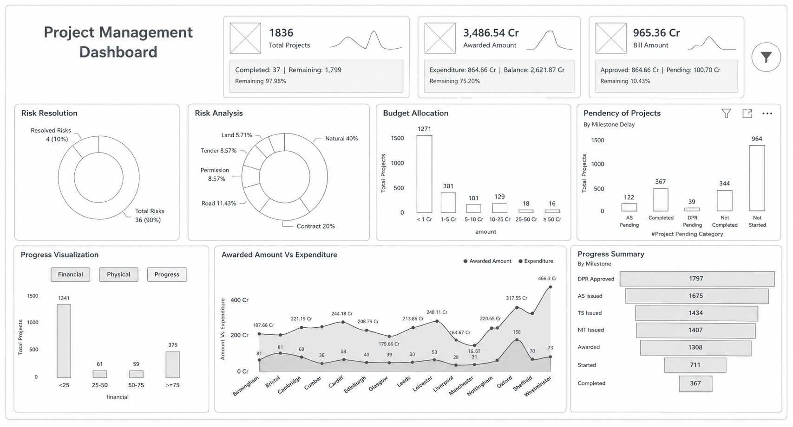
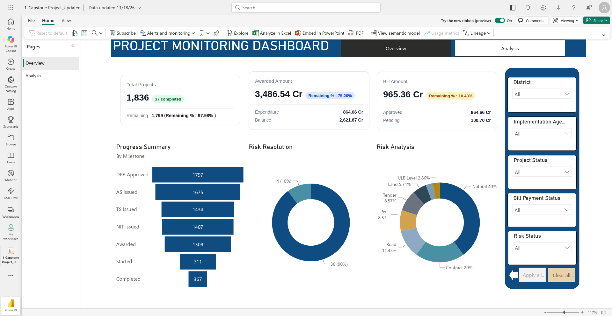
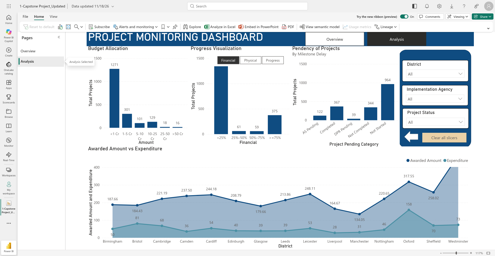

# Project Monitoring Dashboard (Power BI)

A data-analytics capstone project: a Power BI dashboard that monitors a portfolio of 1,836 infrastructure projects through their approval pipeline (DPR, administrative sanction, technical sanction, tender, award, execution, completion), tracking progress, expenditure, billing and risk in one report.

Based on a real government project monitoring dashboard; the data in this repository has been manipulated and uses demo figures for portfolio purposes - no real project figures, names or identifying details are included. The source workbook and the .pbix file are not included in this repository.

## Data model

Five source tables (about 120 columns in total), related through 4 active many-to-one, single-direction relationships:

| Table | Rows | Role |
| --- | --- | --- |
| Project Details | 1,836 | one row per project - the hub |
| Package Details | 1,585 | work packages, linked on Project Code2 |
| Bill Expenditure | 1,155 | bills, linked on Project Code |
| Risk Details | 36 | risks, linked on Project Code |
| Risk Master | 14 | risk-code lookup off Risk Details |

Measures live in a disconnected Measures Table, and a field parameter (Progress Visualization) drives the progress toggle - both disconnected by design.

## Report

Two pages behind a nav bar, with a bookmark-driven hide/show slicer panel on each (District, Implementation Agency, Project Status, Tranche filters):

- **Overview:** three KPI cards rendered with the HTML Content custom visual (styled DAX measures), risk-resolution and risk-category donuts, and the 7-stage cumulative pipeline funnel.
- **Analysis:** budget-allocation and pendency column charts, the 3-way progress toggle (Financial / Physical / Progress difference), and a district-level awarded-vs-expenditure area chart.

Custom theme applied report-wide.

## Design and requirements

*The original requirements wireframe from the brief - the design mockup the dashboard was planned from.*

The finished report (captured from the published file, data manipulated with demo figures):

**Overview page** - HTML-styled KPI cards, milestone funnel, risk donuts and the bookmark-driven slicer panel:

**Analysis page** - budget allocation, pendency, the 3-way progress toggle and the district-level awarded-vs-expenditure chart:

Full background in [docs/requirements.md](docs/requirements.md) (what the brief required), [docs/method.md](docs/method.md) (how it was built, including the consolidation from a 4-page draft design into the final 2-page report) and [docs/features.md](docs/features.md) (every implemented feature: pages, visuals, slicers, bookmarks, measures).

## What the dashboard surfaces (training dataset)

- 75.20% of awarded value unspent: 3,486.54 Cr awarded vs. 864.66 Cr expenditure (balance 2,621.87 Cr)
- 10.43% of billing pending: 100.70 Cr of 965.36 Cr billed
- 964 of 1,836 projects (52.5%) sanctioned but not started
- Funnel narrowing from 1,797 DPR-approved projects to 367 at the Completed stage
- Note on the two "completed" numbers: the KPI card counts Project Status = "Physically Completed" (37 projects), while the funnel's Completed stage counts Project Status = "Completed" (367) - both are real, distinct status values in the data, as the brief specifies.

## Repository contents

| Path | Purpose |
| --- | --- |
| `dax/calculated-columns.dax` | The 13 calculated columns from the final file: budget bands, progress ratios and bands, sort keys, pending status, milestone |
| `dax/measures.dax` | The 30 measures from the final file: funnel, KPI, billing and risk logic, plus the styled HTML behind the KPI cards |
| `docs/requirements.md` | Faithful summary of the programme's functional requirements brief |
| `docs/method.md` | How the dashboard was built: model, columns, measures, design and verification |
| `docs/features.md` | Implemented features: pages, visuals, slicers, bookmarks, measures |
| `docs/wireframe-requirements.png` | The original requirements wireframe (design mockup, not the finished dashboard) |
| `docs/overview.png`, `docs/analysis.png` | Screenshots of the finished report's two pages |
| `.gitignore` | Keeps the workbook and .pbix out of commits |

## Techniques worth noting

- **Banded categories with sort keys:** each `SWITCH(TRUE(), ...)` category column pairs with a hidden numeric sort column so charts order bands correctly.
- **Cumulative funnel vs. pendency:** the funnel counts every project that reached each stage; the pendency chart partitions projects into non-overlapping buckets that reconcile to the 1,836 total.
- **HTML-content KPI cards:** the KPI cards are DAX measures returning styled HTML, rendered through the HTML Content custom visual - full control over layout, badges and colours.
- **Bookmark slicer panel:** a filter icon toggles a slicer panel via paired bookmarks per page, keeping the canvas clean.
- **Defensive DAX:** `DIVIDE()` with an explicit default so blank or zero amounts return 0/blank instead of breaking visuals.

## Notes and provenance

- DAX files were extracted from the author's final .pbix (September 2026) and are verbatim, including table and field names.
- The underlying workbook is the training programme's data and is intentionally not published; row counts and headline figures above are computed from the final model.
- The requirements brief and intermediate planning docs are the training programme's/session material and are likewise not published.
