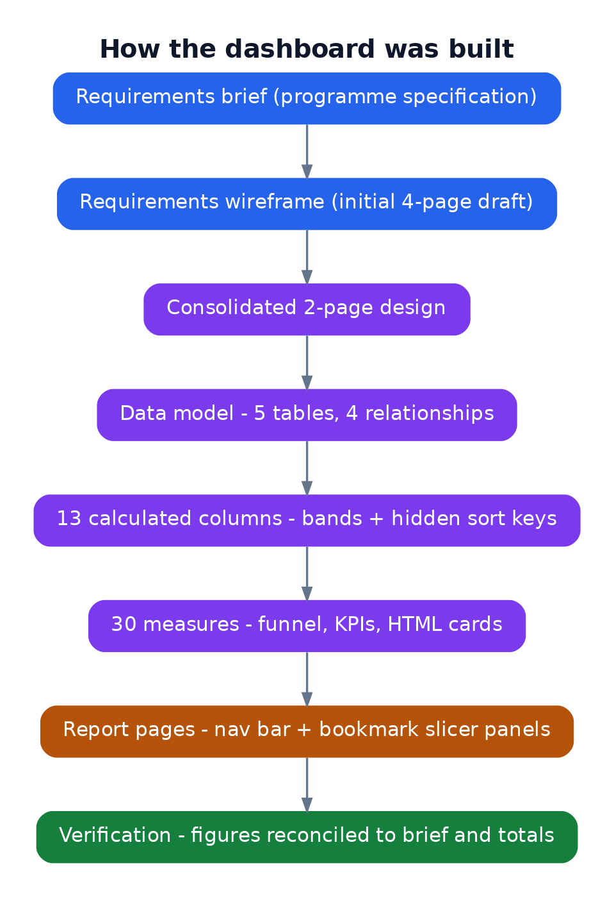
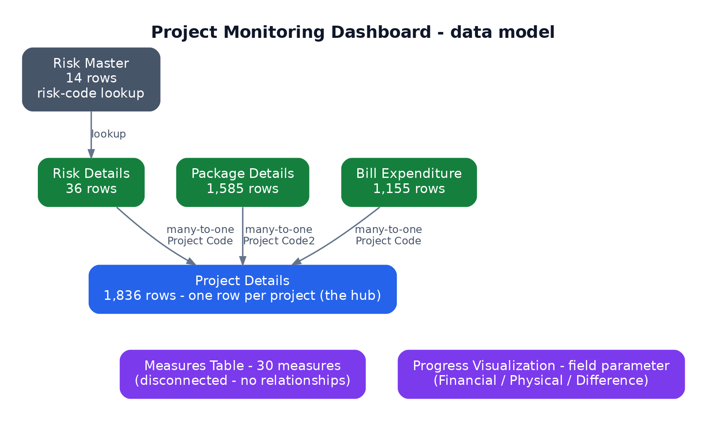
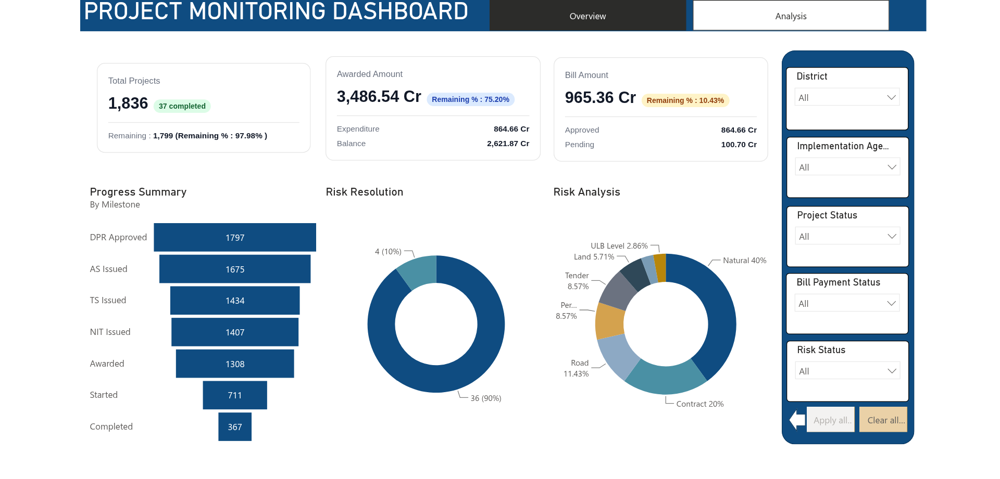
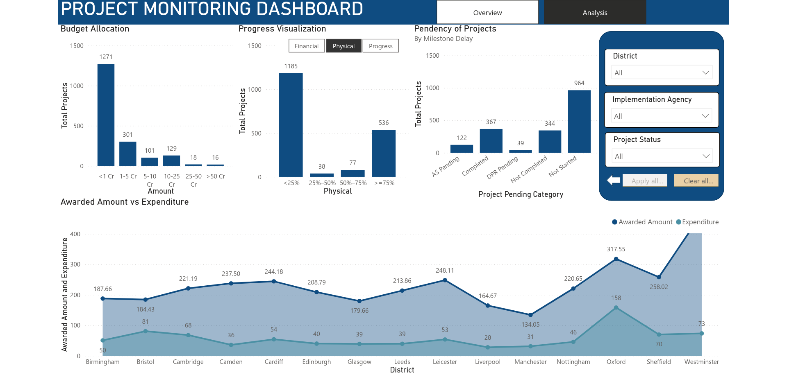

# Step-by-step walkthrough - Project Monitoring Dashboard

This document explains how the dashboard is put together and how to read it: what each part of the DAX does, why it is written that way, and how the pieces connect. All DAX excerpts are the project's actual code (extracted verbatim from the author's final .pbix), with annotations added for explanation. Where an excerpt is shortened, that is marked.

## How it was built



*Explanatory diagram of the build process. The full account is in [method.md](method.md).*

The programme brief arrived with a requirements wireframe for a 4-page report. Analysis of the brief showed the same questions could be answered with two well-designed pages, so the draft was consolidated: an Overview page for headline position (KPIs, funnel, risk) and an Analysis page for diagnosis (budget, pendency, progress, districts).

## The data model, and why it is a hub with spokes



*Explanatory diagram of the as-built model.*

- **Why Project Details is the hub:** every question the brief asks is about projects, and one row per project (1,836 rows) is the natural centre. Packages, bills and risks are things that happen *to* a project, so they hang off it through many-to-one, single-direction relationships.
- **Why single-direction filters:** filters flow from the one side to the many side only, so slicing by a project attribute (district, implementation agency, project status) correctly reduces packages, bills and risks - and unrelated tables can never filter each other in surprising ways.
- **Why the Measures Table is disconnected:** it has no data and no relationships; it exists only to keep all 30 measures in one visible folder in the field list, a common housekeeping pattern.
- **Why a field parameter for the progress toggle:** the Financial / Physical / Progress difference switch swaps the measure an entire chart shows. A field parameter does that natively - one slicer, no bookmarks or duplicated charts.

## Reading the report, step by step

1. **Open the Overview page.** The three KPI cards across the top give the headline position: project completion, awarded-versus-spent, and billed-versus-pending. The funnel shows how many projects survive each approval stage; the donuts show risk resolution and category mix.
2. **Open the slicer panel.** Each page has a filter icon in the nav bar; clicking it shows the slicer panel, clicking again hides it (a bookmark pair per page - one bookmark captures the panel visible, one captures it hidden). The Overview panel carries District, Implementation Agency, Project Status, Bill Payment Status and Risk Status; the Analysis panel carries District, Implementation Agency and Project Status. Both panels have Apply all / Clear all slicers buttons.
3. **Slice.** Pick a district or status; every visual on the page filters through the model's relationships.
4. **Switch to the Analysis page** from the nav bar for diagnosis: budget allocation by sanction band, pendency buckets, the progress toggle and the district-level awarded-vs-expenditure chart.
5. **Use the progress toggle** (Financial / Physical / Progress difference) to flip the progress chart between money spent, work done, and the gap between the two - the gap view is the early-warning view: a project far ahead on paper but behind on the ground stands out immediately.

The finished pages, captured from the published file (data manipulated with demo figures):

**Overview:**



**Analysis:**



## The DAX, annotated

### The funnel: cumulative gates

```sql
DPR Approved =
CALCULATE(COUNTROWS('Project details'), NOT ISBLANK('Project details'[DPR Date]))

AS Issued =
CALCULATE(COUNTROWS('Project details'), 
    NOT ISBLANK('Project details'[DPR Date]), NOT ISBLANK('Project details'[AS Date]))
```

- **What:** each stage counts projects that have a date for that stage *and every earlier stage*.
- **Why cumulative:** a funnel answers "how far did projects get?", so a project that reached Technical Sanction must also count at DPR and AS. Adding each earlier `NOT ISBLANK` condition encodes the gate order in the measure itself.
- **Why some stages switch to `DISTINCTCOUNT('Package details'[Project Code2])`:** tender, award and NIT are package-level events recorded in Package Details, not project-level dates. Counting distinct projects through that table keeps the funnel in project units while reading package data.

### Two "completed" numbers that are both right

```sql
Completed =
CALCULATE(DISTINCTCOUNT('Project details'[Project Code]), 'Project details'[Project Status] = "Completed")

Completed Projects =
CALCULATE(DISTINCTCOUNT('Project details'[Project Code]), 'Project details'[Project Status]="PHYSICALLY COMPLETED")
```

- **Why two measures:** the data holds two distinct status values - "Completed" (367 projects, the funnel's final stage) and "Physically Completed" (37 projects, the KPI card). They mean different things in the source system, and the brief uses both, so the model keeps both rather than collapsing them.

### Banded categories with hidden sort keys

```sql
AS Amount Category =
SWITCH(
    TRUE(),
    'Project details'[AS Amount] < 10000000,  "<1 Cr",
    'Project details'[AS Amount] < 50000000,  "1-5 Cr",
    /* ... */
    ">50 Cr"
)

AS Amount Category Sort =
SWITCH(
    TRUE(),
    'Project details'[AS Amount] < 10000000,  1,
    'Project details'[AS Amount] < 50000000,  2,
    /* ... */
    6
)
```

- **What:** one column buckets each project into a labelled band; a twin column holds the band's order as a number.
- **Why the twin column:** Power BI sorts text alphabetically, so "1-5 Cr" would sort before "<1 Cr". Setting the label column's *Sort by column* property to the numeric twin makes charts order bands by size. The sort column is hidden from the report view because users never need to see it.
- **Why `SWITCH(TRUE(), ...)`:** it evaluates conditions in order and stops at the first match, which reads exactly like the band boundaries are written - clearer and less error-prone than nested IFs.

### Defensive division

```sql
Awarded Amount (Cr) =
DIVIDE(SUM('Project details'[Awarded Amount]), 10000000, 0)
```

- **Why `DIVIDE()` rather than `/`:** DIVIDE returns its fallback when the denominator is zero or blank instead of erroring. In these conversion measures the denominator is the constant 10,000,000, so the explicit `0` fallback is a safety net. The protective case is real in the `Financial Progress` calculated column - `DIVIDE('Project details'[Total Project Expenditure], 'Project details'[Awarded Amount])` - where a project with no awarded amount returns blank instead of an error, so ratio visuals over filtered slices degrade gracefully.
- **Why divide by 10,000,000:** the source amounts are in rupees; the brief presents money in crore, so the conversion lives inside the measures and every visual shows Cr consistently.

### The KPI cards are DAX-generated HTML

```sql
Card_TotalProjects_HTML =
"<div style='font-family:Segoe UI, sans-serif; ... border-radius:12px; ...'>" &
  "<div style='font-size:13px; color:#6B7280; ...'>Total Projects</div>" &
  "<div style='display:flex; align-items:baseline; gap:8px; ...'>" &
    "<span style='font-size:24px; font-weight:600; ...'>" & FORMAT([Total Projects], "#,0") & "</span>" &
    "<span style='... background:#DCFCE7; color:#166534; ...'>" & FORMAT([Completed Projects], "0") & " completed" & "</span>" &
  "</div>" &
  /* ... divider and remaining row ... */
"</div>"
```

*Excerpt shortened; the full measures are in [../dax/measures.dax](../dax/measures.dax).*

- **What:** each KPI card is a measure that returns a string of styled HTML, rendered by the HTML Content custom visual.
- **Why not a standard card visual:** the brief's design calls for a layout standard cards cannot do - a headline number, a coloured badge ("37 completed", "75.20%"), a divider and a detail row, all in one tile with controlled spacing and colours. Generating HTML in the measure gives full layout control while every number stays live: the strings embed `FORMAT([measure], ...)` calls, so the cards re-render from the data on every slice.
- **Why companion text measures exist:** measures like `Remaining % (Project)` assemble the "Remaining % : 75.20%" strings once and are reused inside the HTML, keeping the card measures shorter.

### Pendency buckets reconcile to the total

The pendency chart partitions projects into non-overlapping buckets (not sanctioned, sanctioned not started, started not completed, completed), so the bars sum back to the 1,836 total - a built-in reconciliation check, unlike the funnel whose stages intentionally overlap.

## What the dashboard surfaces (training dataset)

- 75.20% of awarded value unspent: 3,486.54 Cr awarded vs. 864.66 Cr expenditure (balance 2,621.87 Cr)
- 10.43% of billing pending: 100.70 Cr of 965.36 Cr billed
- 964 of 1,836 projects (52.5%) sanctioned but not started
- Funnel narrowing from 1,797 DPR-approved projects to 367 at the Completed stage

## Known limitation

The district-level awarded-vs-expenditure area chart uses a fixed value axis (0-400), so the peak district (about 406 Cr) clips slightly at the top. This is a limitation of the source report as built and is preserved as-is; changing it would mean editing the author's report file, which is intentionally not part of this repository.

## Provenance and test status

- DAX files were extracted from the author's final .pbix (September 2026) and are verbatim, including table and field names.
- The underlying workbook is the training programme's data and is intentionally not published; headline figures are computed from the final model, and the data shown is manipulated demo data.
- Based on a real government project monitoring dashboard; the published material is documentation and code extracts only.
